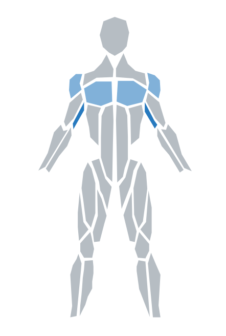

# [react-body-highlighter](https://www.npmjs.com/package/react-body-highlighter)

[](https://github.com/giavinh79/react-body-highlighter/actions/workflows/ci.yml)
[![Npm Version][npm-version-image]][npm-version-url]
[![License][license-image]][license-url]
[![Downloads][downloads-image]][downloads-url]

This package was created to have a body highlighter component compatible with React.js with minimal dependencies and some extra props for further functionality. The SVG polygons were leveraged from the React Native package [react-native-body-highlighter](https://github.com/HichamELBSI/react-native-body-highlighter).

<p align="center">
  
</p>

## Installation

```sh
$ npm install react-body-highlighter
```

```sh
$ yarn add react-body-highlighter
```

## Usage

**Example**

[Storybook](https://master--6aa5e76e0f92a66685e95444.chromatic.com) shows every prop with live controls.

```ts
import React from 'react';
import Model, { IExerciseData, IMuscleStats } from 'react-body-highlighter';

export default function Component() {
  const data: IExerciseData[] = [
    { name: 'Bench Press', muscles: ['chest', 'triceps', 'front-deltoids'] },
    { name: 'Push Ups', muscles: ['chest'] },
  ];

  const handleClick = React.useCallback(({ muscle, data }: IMuscleStats) => {
    const { exercises, frequency } = data;

    alert(`You clicked the ${muscle}! You've worked out this muscle ${frequency} times through the following exercises: ${JSON.stringify(exercises)}`)

  }, [data]);

  return (
    <Model
      data={data}
      style={{ width: '20rem', padding: '5rem' }}
      onClick={handleClick}
    />
  );
}
```

## Props

All props are optional so if they are not passed to the component, they will fallback to default values or be undefined.

| Prop              | Purpose                                                                                                                                                                                                                                                        | Type          | Default                  |
| ----------------- | -------------------------------------------------------------------------------------------------------------------------------------------------------------------------------------------------------------------------------------------------------------- | ------------- | ------------------------ |
| bodyColor         | Default color of unworked body muscle                                                                                                                                                                                                                          | String        | `#B6BDC3`                |
| data              | Data array containing exercise JSON objects: `{ name: 'Bicep Curl', muscles: ['biceps'] }`. While the `name` and `muscles` attributes are required, you may optionally provide another attribute `frequency` to represent the exercise count/intensity.        | Object[]      |                          |
| highlightedColors | Array containing colors to display depending on frequency a muscle was worked (array[frequency-1] = color). See the Frequency Scale story in Storybook.                                                                                                        | []            | `['#0984e3', '#74b9ff']` |
| onClick           | Callback when a muscle is clicked, or activated with Enter or Space. Passed `{ muscle: 'chest', data: { exercises: ['Bench Press'], frequency: 1 } }`. Supplying it also makes the model keyboard navigable, as described under _Keyboard and screen readers_. | (stats) => {} |                          |
| style             | CSSProperties style object that gets passed to SVG's parent container (div)                                                                                                                                                                                    | Object        |                          |
| svgStyle          | CSSProperties style object that gets passed to SVG element                                                                                                                                                                                                     | Object        |                          |
| type              | Denotes type of model view (values: `anterior` or `posterior`)                                                                                                                                                                                                 | String        | `anterior`               |

## List of muscles/parts supported

```
/* Back */
trapezius
upper-back
lower-back

/* Chest */
chest

/* Arms */
biceps
triceps
forearm
back-deltoids
front-deltoids

/* Abs */
abs
obliques

/* Legs */
adductor
hamstring
quadriceps
abductors
calves
gluteal

/* Head */
head
neck
```

## Keyboard and screen readers

Passing `onClick` turns each muscle into a button, so the model can be operated without a mouse. Without
`onClick` it is inert: the SVG is `role="img"` and nothing is focusable.

| Key           | Moves to                                                                        |
| ------------- | ------------------------------------------------------------------------------- |
| Tab           | The model, once. A second Tab leaves it, whatever the muscle count.             |
| Up / Down     | The muscle above or below, wrapping at the ends.                                |
| Left / Right  | Between the body and the arms, to the muscle level with the current one.        |
| Home / End    | The topmost or bottommost muscle of the body or the arms, whichever you are in. |
| Enter / Space | Fires `onClick` for the focused muscle.                                         |

The muscles read as two columns, the body down the middle and the arms beside it, so holding Down walks
the torso into the legs without detouring through an arm. Because there are only two columns, Left and
Right both cross between them.

A muscle is one button covering both sides of the body, so `biceps` is a single stop and the focus ring
appears on the left and right shape together. The ring is drawn on the muscle outline under
`:focus-visible` only, so mouse clicks show nothing. Recolor it with the `--rbh-focus-color` custom
property, which defaults to `currentColor`.

## Modifying

The main SVG element has a class name `.rbh` which will allow you to manually change any styles necessary.

For example, you can add something like `.rbh polygon:hover { fill: #757782 !important; }` to your `.css` file to change the muscle color on mouse hover.

Otherwise, feel free to fork the repo and make any adjustments to your liking!

## Development

```sh
pnpm install
pnpm dev              # Storybook on http://localhost:6006 with hot reload
pnpm test             # unit tests under happy-dom
pnpm build            # ESM, CJS and declarations into dist/
pnpm build-storybook  # static Storybook into storybook-static/
```

Lint and formatting run on staged files through lefthook.

[license-image]: http://img.shields.io/npm/l/react-body-highlighter.svg
[license-url]: LICENSE
[downloads-image]: http://img.shields.io/npm/dm/react-body-highlighter.svg
[downloads-url]: http://npm-stat.com/charts.html?package=react-body-highlighter
[npm-version-image]: https://img.shields.io/npm/v/react-body-highlighter.svg
[npm-version-url]: https://www.npmjs.com/package/react-body-highlighter
